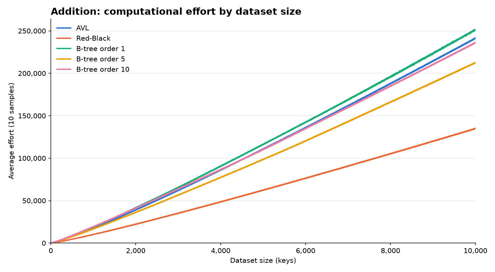
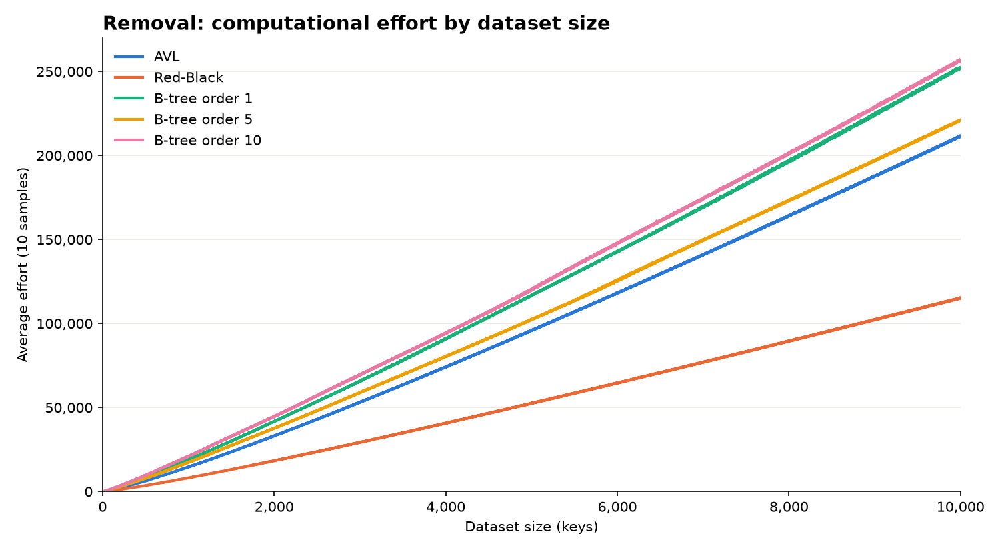

# Tree Balance Benchmark

**English** | [Portuguese](README.pt-BR.md)

A C benchmark that compares the computational effort of balanced trees on insertion and deletion, including the balancing work, using the same random keys for every structure.

The compared trees are AVL, Red-Black and B-tree with orders 1, 5 and 10.

## What is measured

For every dataset size from 1 to 10,000 keys, the program measures the effort of:

- **Addition:** inserting every key of the dataset into an empty tree.
- **Removal:** removing every inserted key.

Each size is run with 10 different random datasets, and the result is the average of the 10 runs. All five trees receive the same dataset in each run.

### Computational effort

The effort is a counter (`effort`, in `src/utils/`) incremented by one at:

- every iteration of a loop inside an addition or removal (descending the tree, finding the successor or predecessor, walking up while balancing, shifting keys inside a B-tree node);
- every balancing operation (AVL and Red-Black rotations, B-tree split, merge and borrow, and each node visited by the B-tree recursion).

### Keys

Keys are generated with `rand() % (10 * n)`, where `n` is the dataset size. Repeated keys are ignored by every tree.

## Charts

To generate the charts from the most recent results file:

```bash
make plot
```

On the first run, the command creates a Python virtual environment (`.venv`) and installs `pandas` and `matplotlib` from `requirements.txt`. The script `scripts/plot_results.py` reads the latest `src/results/results_*.csv` and overwrites `public/addition_effort.png` and `public/removal_effort.png`, so the images below are always up to date.

## Results





## Requirements

- GCC
- Make
- Python 3 (only for the charts)

## How to build and run

To build:

```bash
make compilation
```

To build and run:

```bash
make run
```

The program runs without any input and prints its progress every 500 sizes. Each run creates a new file `src/results/results_<date>_<time>.csv` (ignored by git), with one line per dataset size:

```
dataset_size,avl_add,red_black_add,btree_1_add,btree_5_add,btree_10_add,avl_remove,red_black_remove,btree_1_remove,btree_5_remove,btree_10_remove
```

## Project structure

```
.
├── makefile
├── requirements.txt           # Python dependencies for the charts
├── public/                    # Charts used in the README
├── scripts/
│   └── plot_results.py        # Generates the charts
└── src
    ├── results/               # Results (CSV)
    ├── main.c                 # Main benchmark flow
    ├── trees
    │   ├── avl/               # AVL tree
    │   ├── red_black/         # Red-Black tree
    │   └── btree/             # B-tree
    └── utils/                 # Random keys and effort counter
```
