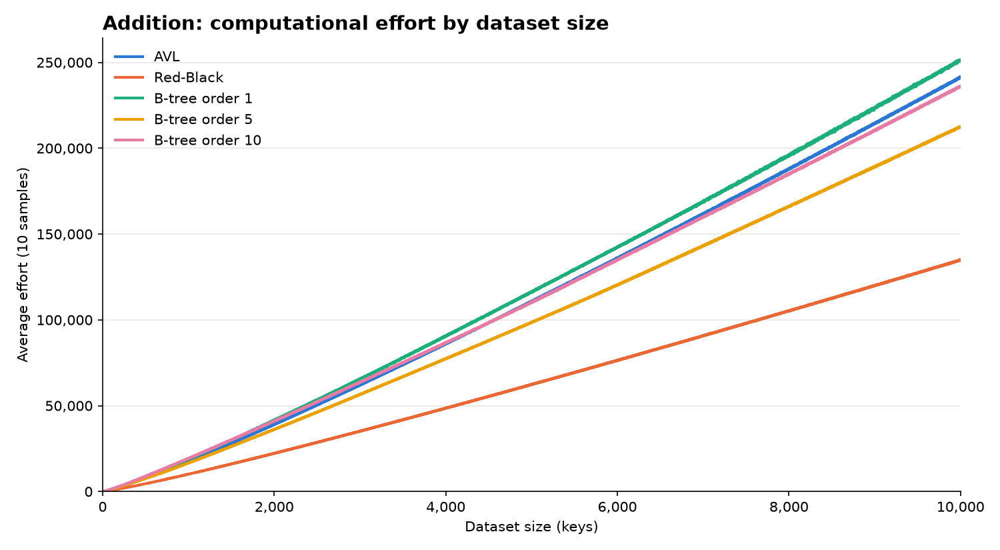
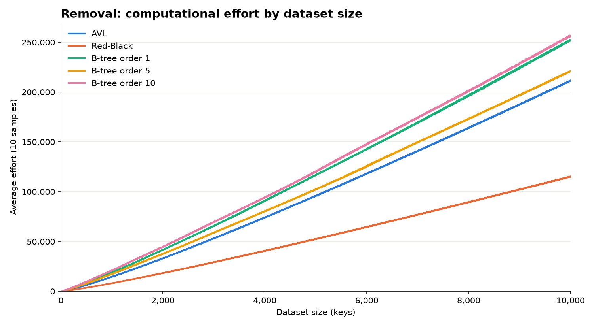

# Tree Balance Benchmark

[Inglês](README.md) | **Português**

Benchmark em C que compara o esforço computacional de árvores balanceadas na adição e na remoção de chaves, incluindo o trabalho de balanceamento, usando as mesmas chaves aleatórias para todas as estruturas.

As árvores comparadas são AVL, Rubro-Negra e Árvore B com ordens 1, 5 e 10.

## O que é medido

Para cada tamanho de conjunto, de 1 a 10.000 chaves, o programa mede o esforço de:

- **Adição:** inserir todas as chaves do conjunto em uma árvore vazia.
- **Remoção:** remover todas as chaves inseridas.

Cada tamanho é executado com 10 conjuntos aleatórios diferentes, e o resultado é a média das 10 execuções. As cinco árvores recebem o mesmo conjunto em cada execução.

### Esforço computacional

O esforço é um contador (`effort`, em `src/utils/`) incrementado em um a cada:

- iteração de laço dentro de uma adição ou remoção (descida na árvore, busca do sucessor ou predecessor, subida durante o balanceamento, deslocamento de chaves dentro de um nó da Árvore B);
- operação de balanceamento (rotações da AVL e da Rubro-Negra; split, merge e empréstimo da Árvore B; e cada nó visitado pela recursão da Árvore B).

### Chaves

As chaves são geradas com `rand() % (10 * n)`, onde `n` é o tamanho do conjunto. Chaves repetidas são ignoradas por todas as árvores.

## Gráficos

Para gerar os gráficos a partir do arquivo de resultados mais recente:

```bash
make plot
```

Na primeira execução, o comando cria um ambiente virtual Python (`.venv`) e instala `pandas` e `matplotlib` a partir do `requirements.txt`. O script `scripts/plot_results.py` lê o `src/results/results_*.csv` mais recente e sobrescreve `public/addition_effort.png` e `public/removal_effort.png`, então as imagens abaixo estão sempre atualizadas.

## Resultados





## Requisitos

- GCC
- Make
- Python 3 (apenas para os gráficos)

## Como compilar e executar

Para compilar:

```bash
make compilation
```

Para compilar e executar:

```bash
make run
```

O programa roda sem nenhuma entrada e mostra o progresso a cada 500 tamanhos. Cada execução cria um novo arquivo `src/results/results_<data>_<hora>.csv` (ignorado pelo git), com uma linha por tamanho de conjunto:

```
dataset_size,avl_add,red_black_add,btree_1_add,btree_5_add,btree_10_add,avl_remove,red_black_remove,btree_1_remove,btree_5_remove,btree_10_remove
```

## Estrutura do projeto

```
.
├── makefile
├── requirements.txt           # Dependências Python dos gráficos
├── public/                    # Gráficos usados no README
├── scripts/
│   └── plot_results.py        # Gera os gráficos
└── src
    ├── results/               # Resultados (CSV)
    ├── main.c                 # Fluxo principal do benchmark
    ├── trees
    │   ├── avl/               # Árvore AVL
    │   ├── red_black/         # Árvore Rubro-Negra
    │   └── btree/             # Árvore B
    └── utils/                 # Chaves aleatórias e contador de esforço
```
